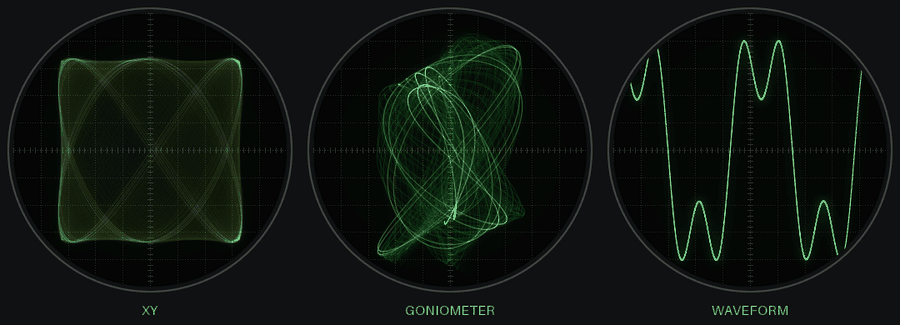
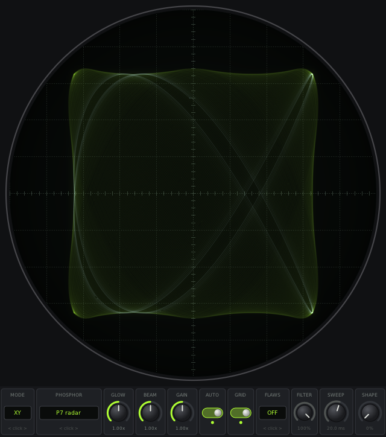
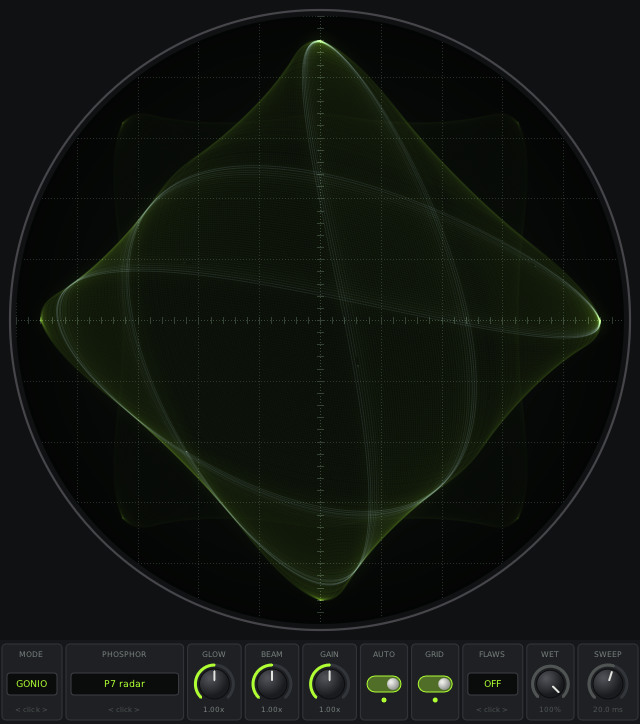
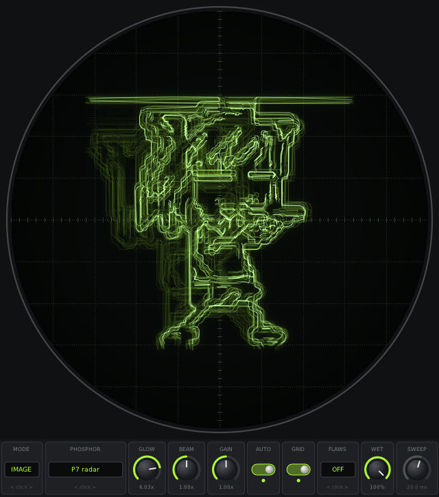
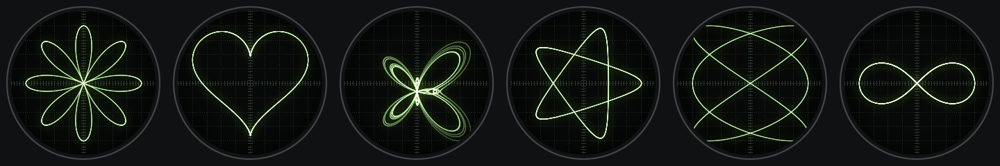
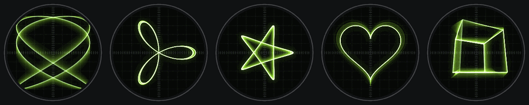
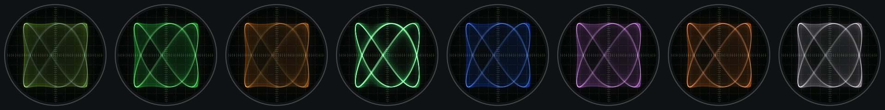

# CRT Scope (VST3 / AU / CLAP)

The [crtscope](https://github.com/plebdui/crtscope) tube as a plugin: put it on a
mixer track and its window draws that track's sound as a 1960s CRT oscilloscope.
The audio passes through untouched, unless you turn on FLAWS or load a picture.

<p align="center">
  
</p>

<p align="center">
  
  
</p>

- **Modes:** XY (Lissajous), goniometer, a triggered waveform, IMAGE and EQUATION
- **Pictures:** drag a GIF, PNG, JPG or BMP onto the window (or click the tube
  in IMAGE mode to pick one) and the beam traces its outlines; GIFs animate and
  the music shakes the picture. The file is saved with your FL project.
- **The picture shapes the sound** in IMAGE mode: the beam's path around the
  outline becomes a tremolo (left/right moves the left channel, up/down the
  right), and busy frames sound bright, sparse ones dark. GIFs change it every frame.
- **Phosphors:** P7 radar, P1 green, P12 orange, P31, plus 15 Apple II colours
- **FLAWS** (off / subtle / worn): an old tube's 60Hz mains hum, drift and
  flicker, on the picture and on the sound (hum ~41 dB / ~29 dB under the music)
- **WET** (0-100%): how much of the flaws and the picture reach the sound
- **SHAPE** (0-100%): plays the picture or equation *as* sound, like
  oscilloscope music (left = x, right = y). Its pitch follows the note in the
  incoming audio and it plays about as loud as the input on average (peaks kept
  just under full scale). 0% = only your
  input, 100% = only the shape. Curves with several loops (a 3:2 Lissajous,
  a rose) sound in harmonics above the tracked note.
- **MIDI** switch: SHAPE follows MIDI notes instead of the input, like a
  synth. The last held note sets the pitch, velocity the level (full velocity
  peaks just under full scale), and the shape
  goes quiet when you let go. The tube shows the note being played and the
  lamp under MIDI blinks with each note; "MIDI ON: NO NOTES ARRIVING" means
  the host isn't sending any. In FL: open the plugin's gear menu and set its
  **MIDI input port** to a number, add a **MIDI Out** channel set to the same
  port, and play or draw notes on that channel. On Mac, use **CRT Scope MIDI** in Logic (under MIDI-controlled
  Effects); the plain CRT Scope AU, the one GarageBand lists, gets no MIDI.
- **Controls** along the bottom, all automatable:
  - **knobs** (GLOW, BEAM, GAIN, WET, SWEEP, SHAPE): drag up/down or scroll to turn,
    right-click to reset
  - **switches** (AUTO, GRID, MIDI): click to flip
  - **selectors** (MODE, PHOSPHOR, FLAWS): left-click / scroll up = next,
    right-click / scroll down = back

<p align="center">
  
</p>

## Equations

EQUATION mode draws built-in parametric curves. Click the left or right half
of the tube (or scroll on it) to change curve; it's also an automatable
parameter. Like pictures, the curve shapes the sound passing through (WET sets
how much), and SHAPE plays the curve itself as sound.

**Static:** rose, heart, butterfly, spirograph, Lissajous knot, infinity



**Animated:** spinning Lissajous, morphing rose, breathing spirograph,
beating heart, rotating cube



Video files and the clock from the terminal version aren't in the plugin.



## Install in FL Studio

Download `CRT-Scope-vst3-windows.zip` from
[Releases](https://github.com/plebdui/crtscope-vst/releases/latest) and unzip it.
Copy the `CRT-Scope.vst3` folder into `C:\Program Files\Common Files\VST3` (on Linux
with Wine: `~/.wine/drive_c/Program Files/Common Files/VST3`), then in FL:
**Options → Manage plugins → Find more plugins**, and add **CRT Scope** to a
mixer track.

## Install on Mac (GarageBand / Logic)

Download `CRT-Scope-mac.zip` from
[Releases](https://github.com/plebdui/crtscope-vst/releases/latest) (one build for
Intel and Apple Silicon), unzip it, then in Terminal:

```sh
cd ~/Downloads
cp -R CRT-Scope.component CRT-Scope-MIDI.component ~/Library/Audio/Plug-Ins/Components/
cp -R CRT-Scope.vst3 ~/Library/Audio/Plug-Ins/VST3/        # optional, for VST3 hosts
xattr -dr com.apple.quarantine ~/Library/Audio/Plug-Ins/Components/CRT-Scope.component ~/Library/Audio/Plug-Ins/Components/CRT-Scope-MIDI.component ~/Library/Audio/Plug-Ins/VST3/CRT-Scope.vst3
```

The plugin isn't signed with a paid Apple developer ID, so without the `xattr`
line macOS blocks it. Restart GarageBand or Logic. In a track's **Plug-ins**
slot it's under **Audio Units → plebdui → CRT Scope**. Drag pictures from
Finder onto the window, or click the tube in IMAGE mode. In Logic, **CRT
Scope MIDI** is under **MIDI-controlled Effects**: pick a MIDI track as its
side chain to play the shape from notes.

## Build (Windows plugin, from Linux)

Needs the mingw-w64 cross compiler (`x86_64-w64-mingw32-g++`).

```sh
git clone https://github.com/plebdui/crtscope-vst.git
cd crtscope-vst
git clone --recursive https://github.com/DISTRHO/DPF.git dpf
git -C dpf apply ../patches/dpf-wine-pixel-format.patch   # see below
git -C dpf apply ../patches/dpf-vst3-no-midi-cc-params.patch
make -C dpf/dgl WINDOWS=true CC=x86_64-w64-mingw32-gcc CXX=x86_64-w64-mingw32-g++ opengl
make WINDOWS=true CC=x86_64-w64-mingw32-gcc CXX=x86_64-w64-mingw32-g++
# -> bin/CRT-Scope.vst3 and bin/CRT-Scope.clap
```

The patch fixes the plugin window failing to open under Wine: Pugl asked for a
pixel format with wglChoosePixelFormatARB, Wine answered "success, 0 formats",
and Pugl used format 0. It now falls back to the basic format that works.
The second patch stops DPF adding 2080 hidden "MIDI CC" parameters to the VST3
when MIDI input is on, so the knobs keep the same parameter numbers and
existing FL automation still points at the right ones.

The Mac build runs on GitHub Actions (`.github/workflows/macos.yml`): a
universal AU + VST3 + CLAP, checked with Apple's `auval -strict`, then
`tests/mac_auhost.mm` opens the window the way Logic does and the plugin saves
snapshots of it.

## Tests

- `tests/render_test.cpp`: draws the tube with test tones to PPM images (native, no host)
- `tests/minihost.cpp`: a tiny VST3 host (mingw, run under Wine) that opens the
  window, streams audio, clicks MODE and checks the result. Given a picture
  path, it also drags it onto the window through OLE (like Explorer), checks
  IMAGE mode turned on and the path is in the saved state; `MINIHOST_SAVE` /
  `MINIHOST_LOAD` save and reopen that state. Set `CRTSCOPE_DUMP`
  to a file path and the window saves snapshots of itself.
- pluginval 1.0.4, strictness 10, under Wine: all tests pass except its editor
  test, which times out under Wine for DPF's own example plugins too (the
  stuck threads are all inside pluginval).
